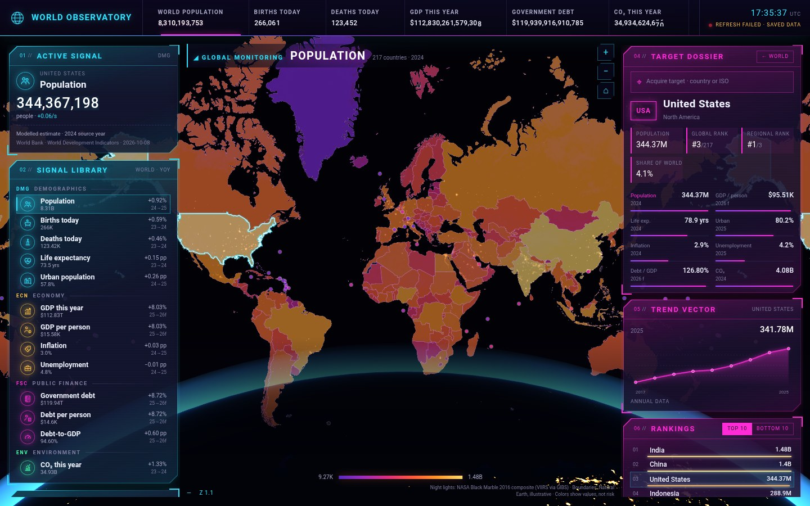

# World Observatory

An interactive dashboard for exploring population, health, the economy, public debt, and emissions. Pick a metric to recolor the world map, then select a country to see rankings, source years, and historical trends.

[Open World Observatory](https://world-observatory.ericzwierzynski.dev)



## How it works

Next.js serves a bundled data snapshot and periodically refreshes it from public sources. MapLibre draws the country layers over NASA night imagery, and Three.js renders the Earth horizon. Rolling counters are model estimates based on published annual data. The dashboard labels source dates and forecasts.

## Run locally

Use Node.js 24 or later and pnpm. No API key or database is required.

```sh
pnpm install --frozen-lockfile
pnpm dev --port 3001
```

Open [localhost:3001](http://localhost:3001). Use `pnpm data:refresh` to regenerate the bundled dataset.

[Methodology, sources, and controls](docs/methodology.md)
